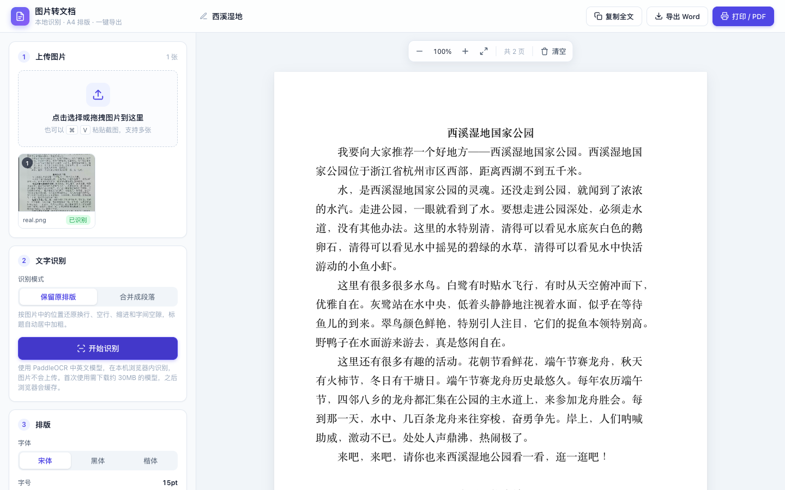

# 图片转文档 · img2doc

把图片里的文字识别出来，排版成 A4 文档，可在线编辑，一键导出 PDF / Word。识别全程在浏览器本地完成，图片不会上传到任何服务器。

在线使用：https://climb0516.github.io/img2doc/



## 功能

- **本地识别**：基于 PaddleOCR（PP-OCRv4）中英文模型，在浏览器内运行，中文识别准确率高
- **按段落还原**：同一段的多行合并成一个段落，随纸张宽度自动换行；原图段首的缩进保留为两个全角空格
- **两栏识别与排版**：自动检测两栏图片（支持拍照倾斜），左右栏分别识别后按「左栏 → 右栏」顺序输出，A4 页面、PDF、Word 均可两栏排版
- **标题自动识别**：居中的短行自动识别为标题，居中加粗显示；标题和称呼等挨得很近时也能分开
- **靠右对齐**：信件落款、日期等靠右的行保持靠右
- **省略号修正**：把识别成「…….·」「··」等的连续点统一为「……」
- **漏字补回**：一行被切成两段时漏掉的「一」「——」会按原图补回；支持拍照倾斜
- **破折号修正**：自动把被误识别成「一」的「——」还原
- **A4 分页预览**：按真实 A4 尺寸分页，可直接在纸上编辑；支持缩放
- **排版调整**：单栏 / 两栏、字体（宋体 / 黑体 / 楷体）、字号、行距、上下 / 左右边距
- **导出**：导出 PDF、导出 Word（.docx，A4 纸张）、打印、复制全文
- **多图批量**：支持点击、拖拽、粘贴截图上传多张图片，可调整顺序

## 技术架构

纯前端单页，没有后端、没有数据库、没有定时任务；图片只在浏览器内存里处理，不上传。

```
用户选择 / 拖拽 / 粘贴图片（addFiles）
  ↓ images[]（内存，状态 pending → running → done / error）
点「开始识别」（recognizeAll）
  ↓ getOcr()：首次从 jsDelivr 下载 PP-OCRv4 检测 / 识别模型 + 字典（约 30MB，浏览器缓存）
  ↓ loadGray()：整图转灰度 → detectGutter() 找栏缝（有两栏就切到两栏排版）
  ↓ 两栏：splitImage() 沿斜线切成左右两张，分别识别
  ↓ ocr.detect()：vendor/paddle-ocr.js（@gutenye/ocr + onnxruntime-web WASM），逐个文本框识别
  ↓ fixDashes()：「一」→「——」修正
  ↓ analyze() + makeGapProbe()：文本框 → 行（缩进 / 空行 / 标题 / 靠右 / 短行 / 补字）
  ↓ toMerged()：行 → 段落 paragraphs[]
       ↓
renderPages()：按 A4 分页渲染，可直接在纸上编辑（collectFromPages() 读回）
  ├─ 导出 PDF：html2canvas（2 倍）→ jsPDF，每页一张 JPEG
  ├─ 导出 Word：docx 库生成 .docx（A4，字体 / 字号 / 行距 / 边距照页面设置）
  └─ 打印 / 复制全文
```

---

## 前端

- **技术栈**：原生 HTML + CSS + JS（单个 IIFE），无框架、无构建；所有逻辑在 `index.html`
- **页面结构**：顶栏（标题、文件名 `#fileName`、复制全文、「导出」下拉菜单：导出 PDF / 导出 Word / 打印）；左侧栏三张卡片：图片列表（缩略图、调整顺序、删除、点开大图）、「开始识别」+ 总进度条、排版设置；右侧工作区：工具条（缩放 `setZoom()`、适应宽度、页数、清空）+ A4 纸张区 `#pages`
- **排版设置**（`applyStyle()` 写 CSS 变量 `--font-family`、`--font-size`、`--line-height`、`--margin-v`、`--margin-h`、`--col-gap`）

| 设置 | 范围 | 默认 |
|------|------|------|
| 栏数 | 单栏 / 两栏（`setColumns()`） | 单栏；检测到两栏图片时自动切两栏 |
| 字体 | 宋体 / 黑体 / 楷体（`FONTS`） | 宋体 |
| 字号 | 9–24 pt，步长 0.5 | 12 pt |
| 行距 | 1–3，步长 0.05 | 1.75 |
| 上下边距 | 10–40 mm | 25 mm |
| 左右边距 | 10–40 mm | 20 mm |
| 栏间距 | 固定 `COL_GAP_MM` | 8 mm |

- **分页**：`renderPages()` 逐段放进当前页，`overflows()` 判断溢出后整段挪到下一页
- **数据存储**：不用 localStorage / IndexedDB，识别结果只在内存（`images`、`paragraphs`），刷新页面就清空；模型文件由浏览器 HTTP 缓存
- **kit 组件**：未使用

---

## 使用方法

1. **上传图片**：点击选择、拖拽，或直接 ⌘V / Ctrl+V 粘贴截图
2. **识别**：点「开始识别」。首次使用需下载约 30MB 的模型，之后浏览器会缓存
3. **排版**：调整字体、字号、行距、边距；也可以直接点击纸张修改文字
4. **导出**：右上角点「导出」，选择「导出为 PDF」或「导出为 Word」；也可以「打印」或「复制全文」

「导出为 PDF」会把每页 A4 转成图片后生成 PDF，和页面效果完全一致，但文字不能选中、搜索，每页约几百 KB。需要文字可选的 PDF 时，点「打印」，在打印窗口中目标选「存储为 PDF」，纸张 A4，边距选「无」。

## 本地运行

不需要构建，直接用 Chrome 打开 `index.html` 即可。识别模型和 PDF / Word 导出库从 jsDelivr CDN 加载，首次使用需要联网。

也可以起一个静态服务器：

```
python3 -m http.server 8000
```

然后访问 http://localhost:8000

## 实现说明

核心算法和阈值速查（都在 `index.html`）：

| 步骤 | 函数 | 关键阈值 |
|------|------|---------|
| 灰度化 | `loadGray()` | 0.299R + 0.587G + 0.114B |
| 自适应阈值 | `otsu()` | Otsu 法 |
| 分栏检测 | `detectGutter()` | 中间 30%–70% 宽度，-4°～4° 步长 0.25°；`GUTTER_MAX_RATIO = 0.1`、`GUTTER_MIN_WIDTH = 0.012`，中位数深色像素 ≥ 20 才判 |
| 切栏 | `splitImage()` | 沿斜线切，另一半涂白，坐标系不变 |
| 破折号修正 | `fixDashes()` | 左右各 2.5 字宽、行高 15%–80%；`DASH_MIN_RATIO = 1.4` 字宽 |
| 行内补字 | `makeGapProbe()` | 空隙 ≥ 0.5 字宽才量；横线 0.5–1.4 字宽补「一」、> 1.4 补「——」；`GAP_MAX_SPREAD = 0.25`；无横线时 ≥ 3 字宽补全角空格 |
| 版面分析 | `analyze()` | 合并为一行：中线高度差 < 0.5 字高；缩进 `floor(偏移 / 字宽 + 0.25)`；空行最多 5 行；标题 ≤ 20 字、左缩进 ≥ 1.75 字宽、中心偏离 < 3 字宽；靠右离右边界 < 1.5 字宽；短行离右边界 > 2 字宽 |
| 合并段落 | `toMerged()` | 标题 / 靠右单独成段；有缩进或空行开新段；英文之间补空格；段首缩进 `PARA_INDENT` |
| 字宽计数 | `charUnits()` | 半角字符按 0.5 个字宽 |

### 段落还原

PaddleOCR 返回每个文本框的文字及其四边形坐标，在此基础上还原段落：

- **行**：沿文本框的倾斜中线延伸到另一个文本框，两者中线高度差不到半个字高时合并为一行；行按倾斜校正后的高度排序。照片倾斜时外接矩形会变高，只看外接矩形会把下一行开头的字拼进上一行
- **行内空隙**：同一行两个文本框之间的空隙超过半个字宽时，在原图上量空隙里最长的横线（阈值取 Otsu 阈值和底色的中间，向两边文本框各多量半个字宽）。横线 0.5–1.4 个字宽补「一」，超过 1.4 个字宽补「——」；离这条横线较远的墨迹超过 25% 时说明空隙里是别的字，不补。没有横线时，不到 3 个字宽直接连接，3 个字宽以上（表单）补全角空格
- **缩进**：与前后各 2 行的最左边界比较，超过 0.75 个字宽算 1 个字；局部边界可以抵消拍照倾斜。右边界取前后各 5 行，避免开头几行都是短行时边界偏小
- **空行**：两行间距按中位行距换算，超出一行的视为空行
- **标题**：单个文本框、不超过 20 字、缩进不少于 2 字、中心距版心中线 3 个字宽以内、不以句末标点结尾。一行里有多个文本框、其中恰好一个符合标题条件时（如标题略高于称呼，被归为同一行），把它拆成单独的标题行
- **靠右**：从版心右半边开始、离右边界不到 1.5 个字宽的行（落款、日期）靠右对齐，单独成段
- **短行**：离右边界超过 2 个字宽就结束的行，视为一段的最后一行
- **分段**：遇到标题、靠右的行、有缩进的行、空行，或上一行是短行时开始新段落，其余行接到上一段末尾；原图段首有缩进的，段首加两个全角空格
- **省略号**：文本框里连续 2 个以上的「.·…・」统一为「……」

### 分栏检测

PaddleOCR 会把左右两栏同一高度的文字检测成一行，所以识别前先在图片上找栏缝：在图片中间 30%–70% 宽度内，按 -4° 到 4°（步长 0.25°）逐条试斜线，统计穿过的深色像素。穿过的深色像素不到普通位置中位数的 10%、且缝宽不小于图片宽度 1.2% 时判为两栏。

判为两栏后，沿斜线把图片切成左右两张（另一半涂白）分别识别；右栏第一行没有缩进时接到左栏最后一段。检测到两栏图片时，页面自动切到两栏。

### 破折号修正

PaddleOCR 常把「——」识别成「一」。对每个「一」，按它在行内的位置估算图片坐标，在左右各 2.5 个字宽、行高 15%–80% 的范围内寻找最长的连续深色横线（每行用 Otsu 自适应阈值）。破折号约 2 个字宽，「一」不到 1 个字宽，超过 1.4 个字宽判为破折号。

浏览器控制台中的 `[Column]`、`[Dash]`、`[Row]`、`[Gap]`、`[Layout]` 日志会输出每次判定的测量值（`[Row]` 输出合并或因倾斜拆开的文本框，`[Gap]` 输出行内空隙的横线测量，`[Layout]` 输出被判为标题、靠右、短行的行），方便调整阈值。

### 导出 PDF

用 html2canvas 把每页 A4 按 2 倍分辨率转成图片，再用 jsPDF 逐页放进 A4 大小的 PDF 中直接下载，不弹出打印窗口。PDF 内容就是页面截图，字体、两栏、换行和分页都与页面显示完全一致。两个库在第一次导出 PDF 时才从 CDN 加载。

## 已知限制

- 段落中局部加粗等字体样式无法还原
- 省略号「……」有时会被识别模型完全漏掉，这种情况无法补回；行内空隙里漏掉的字只能补回「一」「——」，其他字补不回来，两段会直接连接
- 表格、多列清单等需要按位置排列的内容无法还原，只能按行输出
- 原图段落开头没有缩进、段间没有空行，且上一段最后一行正好写满时，相邻段落会被合并成一段
- 一段中间的某行恰好在离右边界 2 个字以上处结束时，会被误断成两段
- 只支持单栏和两栏；栏缝过窄或有跨栏的图片、通栏标题时，可能识别为单栏
- 两栏时 A4 的分页位置与原图不一一对应；Word 中的分栏位置以 Word 排版为准
- 繁体中文识别效果一般
- 如果「一」旁边正好有很长的横线（表格线、下划线），可能被误判为破折号
- 首次使用需下载约 30MB 的模型和运行时
- 「导出为 PDF」生成的是图片，文字不能选中、搜索，文件也较大（两栏 4 页约 2.5MB）；需要可选文字时，用「打印」并在打印窗口中选「存储为 PDF」

## 项目结构

```
index.html             页面、样式和全部逻辑
vendor/paddle-ocr.js   PaddleOCR 浏览器版（本地打包）
docs/screenshot.png    README 截图
```

## 重新打包 vendor/paddle-ocr.js

`@gutenye/ocr-browser` 通过 CDN 的 ESM 自动打包使用时，依赖会被打包坏，所以改为本地用 esbuild 打包成单个文件。

1. 安装依赖

```
npm i @gutenye/ocr-browser@1.4.9 onnxruntime-web esbuild
```

2. 新建入口文件 `entry.js`（`wasmPaths` 中的版本号与安装的 onnxruntime-web 版本保持一致）

`@gutenye/ocr-browser` 自带的 `Ocr.detect` 会把高度相近的文本框拼成一行（文字用空格连接，只保留整行的坐标），标题和称呼挨得近时就分不开。所以入口文件里直接用检测 / 识别模型，逐个识别文本框，保留每个文本框的坐标：

```
import '@gutenye/ocr-browser'
import { Detection, Recognition } from './node_modules/@gutenye/ocr-common/build/models/index.js'
import * as ort from 'onnxruntime-web'
ort.env.wasm.wasmPaths = 'https://cdn.jsdelivr.net/npm/onnxruntime-web@1.30.0/dist/'

// 逐个识别文本框，不把同一高度的文本框拼成一行，保留每个文本框的位置
class Ocr {
  static async create(options = {}) {
    return new Ocr(await Detection.create(options), await Recognition.create(options))
  }
  constructor(detection, recognition) {
    this.detection = detection
    this.recognition = recognition
  }
  async detect(image, options = {}) {
    const { lineImages, resizedImageWidth, resizedImageHeight } = await this.detection.run(image, options)
    const texts = []
    for (const lineImage of lineImages) texts.push(...await this.recognition.run([lineImage], options))
    return { texts, resizedImageWidth, resizedImageHeight }
  }
}
window.PaddleOcr = Ocr
```

3. 打包

```
npx esbuild entry.js --bundle --format=iife --minify --platform=browser --external:fs --external:path --external:crypto --outfile=vendor/paddle-ocr.js
```

识别模型在 `index.html` 的 `MODEL_BASE` 中配置，当前使用 `@gutenye/ocr-models@1.4.2` 中的 PP-OCRv4 检测 / 识别模型。

## 第三方依赖

| 依赖 | 版本 | 加载方式 | 用途 | 许可证 |
|---|---|---|---|---|
| [@gutenye/ocr](https://github.com/gutenye/ocr)（`@gutenye/ocr-browser`） | 1.4.9 | 打包进 `vendor/paddle-ocr.js` | PaddleOCR 浏览器封装 | MIT |
| [PaddleOCR](https://github.com/PaddlePaddle/PaddleOCR) PP-OCRv4 模型（`@gutenye/ocr-models`） | 1.4.2 | jsDelivr，`MODEL_BASE` | 文字检测与识别（`ch_PP-OCRv4_det_infer.onnx`、`ch_PP-OCRv4_rec_infer.onnx`、`ppocr_keys_v1.txt`） | Apache-2.0 |
| [onnxruntime-web](https://github.com/microsoft/onnxruntime) | 1.30.0 | JS 打包进 vendor，WASM 从 jsDelivr 加载 | 模型推理 | MIT |
| [@techstark/opencv-js](https://github.com/TechStark/opencv-js) | 未确认（随 @gutenye/ocr 依赖打包） | 打包进 vendor | 图像处理 | Apache-2.0 |
| [js-clipper](https://sourceforge.net/projects/jsclipper/) | 未确认（随 @gutenye/ocr 依赖打包） | 打包进 vendor | 文本框多边形处理 | Boost |
| [docx](https://github.com/dolanmiu/docx) | 8.5.0 | jsDelivr，页面加载时 | 导出 Word | MIT |
| [html2canvas](https://github.com/niklasvh/html2canvas) | 1.4.1 | jsDelivr，第一次导出 PDF 时 | 导出 PDF（页面转图片） | MIT |
| [jsPDF](https://github.com/parallax/jsPDF) | 2.5.1 | jsDelivr，第一次导出 PDF 时 | 导出 PDF | MIT |

## 许可证

[MIT](LICENSE)
