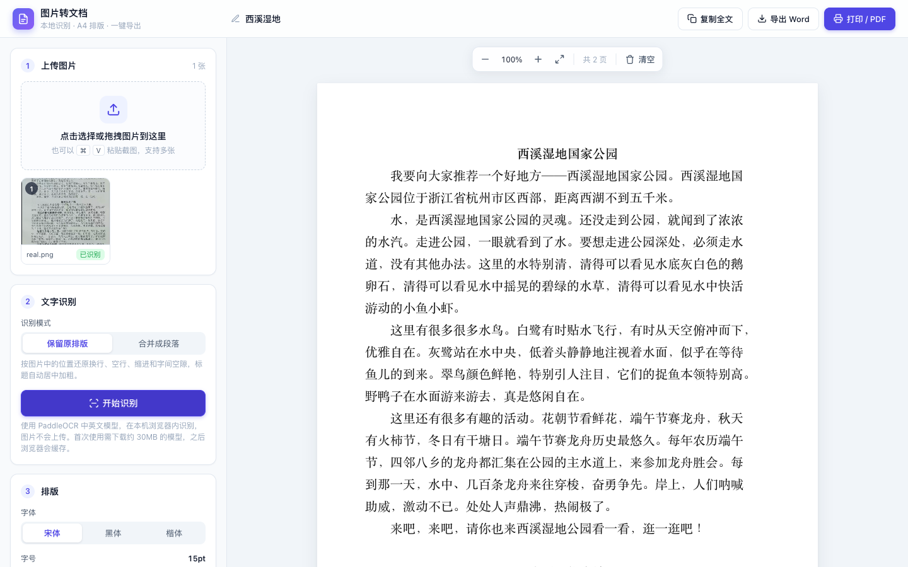

# 图片转文档 · img2doc

把图片里的文字识别出来，排版成 A4 文档，可在线编辑，一键导出 PDF / Word。识别全程在浏览器本地完成，图片不会上传到任何服务器。

在线使用：https://climb0516.github.io/img2doc/



## 功能

- **本地识别**：基于 PaddleOCR（PP-OCRv4）中英文模型，在浏览器内运行，中文识别准确率高
- **两种识别模式**
  - 保留原排版：按图片中的位置还原换行、空行、缩进和字间空隙
  - 合并成段落：同一段的多行合并成一个段落，随纸张宽度自动换行
- **标题自动识别**：居中的短行自动识别为标题，居中加粗显示
- **字号适配原图行宽**：保留原排版时，自动计算字号让每行铺满纸张宽度
- **破折号修正**：自动把被误识别成「一」的「——」还原
- **A4 分页预览**：按真实 A4 尺寸分页，可直接在纸上编辑；支持缩放
- **排版调整**：字体（宋体 / 黑体 / 楷体）、字号、行距、上下 / 左右边距、首行缩进
- **导出**：打印 / 存为 PDF、导出 Word（.docx，A4 纸张）、复制全文
- **多图批量**：支持点击、拖拽、粘贴截图上传多张图片，可调整顺序

## 使用方法

1. **上传图片**：点击选择、拖拽，或直接 ⌘V / Ctrl+V 粘贴截图
2. **识别**：选择识别模式，点「开始识别」。首次使用需下载约 30MB 的模型，之后浏览器会缓存
3. **排版**：调整字体、字号、行距、边距；也可以直接点击纸张修改文字
4. **导出**：右上角选择「打印 / PDF」「导出 Word」或「复制全文」

存为 PDF：在打印窗口中目标选「存储为 PDF」，纸张 A4，边距选「无」。

## 本地运行

不需要构建，直接用 Chrome 打开 `index.html` 即可。识别模型和 Word 导出库从 jsDelivr CDN 加载，首次使用需要联网。

也可以起一个静态服务器：

```
python3 -m http.server 8000
```

然后访问 http://localhost:8000

## 实现说明

### 版面还原

PaddleOCR 返回每一行文字及其四边形坐标，在此基础上还原版面：

- **行**：纵向中心落在同一范围内的文本框合并为一行（多栏、表单）
- **空行**：两行间距按中位行距换算，超出部分插入空行（最多 5 行）
- **缩进**：与前后各 2 行的最左边界比较，超过 0.75 个字宽算 1 个字，用全角空格补齐；局部边界可以抵消拍照倾斜
- **字间空隙**：同一行两个文本框之间超过 0.9 个字宽时补全角空格
- **标题**：单个文本框、不超过 20 字、缩进不少于 2 字、中心距版心中线 3 个字宽以内、不以句末标点结尾

### 字号适配

在页面上实际量出最长一行的渲染宽度，按版心宽度反算字号，向下取整到 0.5pt，范围 9–24pt。手动拖动字号滑块后自动关闭。

### 破折号修正

PaddleOCR 常把「——」识别成「一」。对每个「一」，按它在行内的位置估算图片坐标，在左右各 2.5 个字宽、行高 15%–80% 的范围内寻找最长的连续深色横线（每行用 Otsu 自适应阈值）。破折号约 2 个字宽，「一」不到 1 个字宽，超过 1.4 个字宽判为破折号。

浏览器控制台中的 `[Dash]`、`[AutoFit]` 日志会输出每次判定的测量值，方便调整阈值。

## 已知限制

- 段落中局部加粗等字体样式无法还原
- 省略号「……」可能被识别为「..」
- 表格只还原文字位置，不保留表格结构
- 繁体中文识别效果一般
- 如果「一」旁边正好有很长的横线（表格线、下划线），可能被误判为破折号
- 首次使用需下载约 30MB 的模型和运行时

## 项目结构

```
index.html             页面、样式和全部逻辑
vendor/paddle-ocr.js   PaddleOCR 浏览器版（本地打包）
docs/screenshot.png    README 截图
```

## 重新打包 vendor/paddle-ocr.js

`@gutenye/ocr-browser` 通过 CDN 的 ESM 自动打包使用时，依赖会被打包坏，所以改为本地用 esbuild 打包成单个文件。

1. 安装依赖

```
npm i @gutenye/ocr-browser@1.4.9 onnxruntime-web esbuild
```

2. 新建入口文件 `entry.js`（`wasmPaths` 中的版本号与安装的 onnxruntime-web 版本保持一致）

```
import Ocr from '@gutenye/ocr-browser'
import * as ort from 'onnxruntime-web'
ort.env.wasm.wasmPaths = 'https://cdn.jsdelivr.net/npm/onnxruntime-web@1.30.0/dist/'
window.PaddleOcr = Ocr
```

3. 打包

```
npx esbuild entry.js --bundle --format=iife --minify --platform=browser --external:fs --external:path --external:crypto --outfile=vendor/paddle-ocr.js
```

识别模型在 `index.html` 的 `MODEL_BASE` 中配置，当前使用 `@gutenye/ocr-models@1.4.2` 中的 PP-OCRv4 检测 / 识别模型。

## 第三方依赖

| 依赖 | 用途 | 许可证 |
|---|---|---|
| [@gutenye/ocr](https://github.com/gutenye/ocr) | PaddleOCR 浏览器封装 | MIT |
| [PaddleOCR](https://github.com/PaddlePaddle/PaddleOCR) PP-OCRv4 模型 | 文字检测与识别 | Apache-2.0 |
| [onnxruntime-web](https://github.com/microsoft/onnxruntime) | 模型推理 | MIT |
| [@techstark/opencv-js](https://github.com/TechStark/opencv-js) | 图像处理 | Apache-2.0 |
| [js-clipper](https://sourceforge.net/projects/jsclipper/) | 文本框多边形处理 | Boost |
| [docx](https://github.com/dolanmiu/docx) | 导出 Word | MIT |

## 许可证

[MIT](LICENSE)
